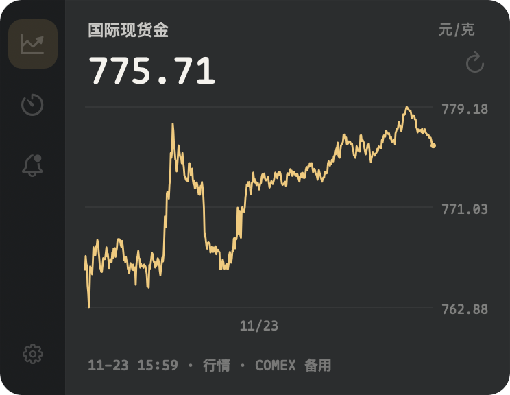
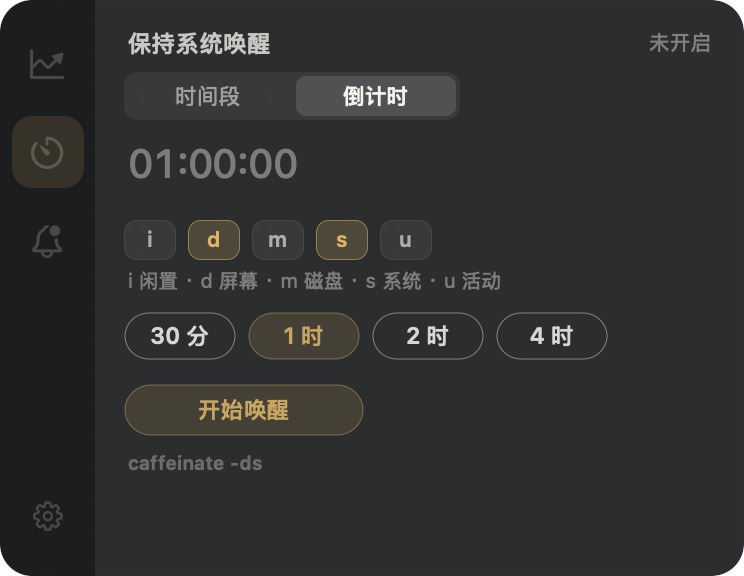
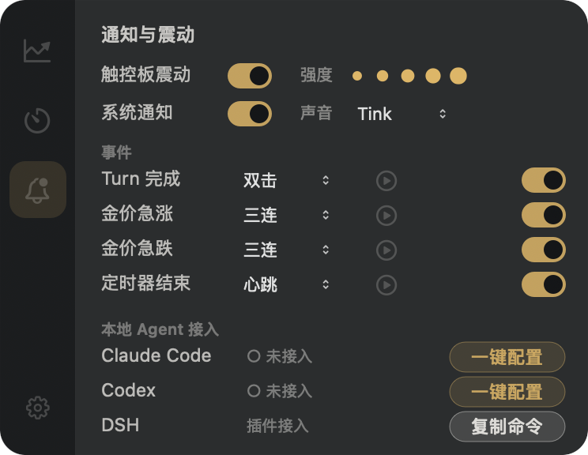
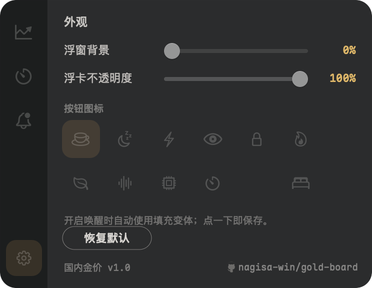

# 国内金价 · 桌面浮窗

一款 macOS 置顶桌面小工具：平时只是一枚显示金价的胶囊浮窗，悬停展开成带左侧三页导航的浮卡。

- **金价**：国际现货黄金按离岸人民币折算的元/克参考价，含分时曲线，接口抖动时多源兜底
- **唤醒定时器**：用 `caffeinate` 保持系统唤醒，支持倒计时与时间段，参数可勾选并记忆
- **通知与震动**：触控板马达拍击 / 节奏 / 旋律共 18 种预设 + 系统通知，含强度与声音，可一键接入本地 Agent 的「Turn 完成」提醒
- **本地缓存**：每分钟记一行，保留 90 天，方便自己拉出来做趋势分析




## 环境要求

- macOS 12 及以上，Apple 芯片或 Intel 均可
- Xcode 命令行工具：`xcode-select --install`
- 震动提醒需要 Force Touch 触控板（2015 年后的 MacBook、Magic Trackpad 2 及更新）

## 构建与运行

```sh
make build      # 等价于 cd src && ./build.sh
make run
```

或手动：

```sh
cd src
./build.sh
open "./build/国内金价.app"
```

脚本生成 Apple 芯片与 Intel 通用的应用包，使用本地 adhoc 签名。若应用包来自网络下载，首次运行先去掉隔离标记：

```sh
xattr -dr com.apple.quarantine "国内金价.app"
```

## 交互

| 操作 | 效果 |
| --- | --- |
| 拖动数字 | 移动浮窗（浮卡跟随移动） |
| 悬停浮窗 | 浮出毛玻璃底并把文字切成白字，250ms 后展开浮卡 |
| 单击数字 | 锁定展开浮卡，点空白处关闭 |
| 单击右侧按钮 | 切换系统唤醒（使用上次勾选的 caffeinate 参数） |
| 右键按钮 | 勾选 `-i/-d/-m/-s/-u` 参数，勾选即记忆 |
| 右键浮窗 | 打开浮卡 / 刷新行情 / 切换唤醒 / 打开缓存目录 / 退出 |
| 浮卡左侧图标 | 金价 · 唤醒定时器 · 通知与震动 |
| 浮卡左下齿轮 | 外观：浮窗背景透明度、浮卡不透明度、按钮图标 |

## 外观

- 数字字体为 [Maple Mono](https://github.com/subframe7536/maple-font)，中文标签用其 NF CN 变体；未安装时自动退回系统等宽数字字体。
- 文字不加描边：透明态黑字，底色加深或悬停时换白字并带一层轻投影。
- 浮窗背景透明度 0–100%（0% 为纯浮字），浮卡不透明度 50–100%。

| 唤醒定时器 | 通知与震动 | 外观 |
| --- | --- | --- |
|  |  |  |

## 发布（GitHub Actions）

推一个 `v*` tag 就会自动编译并发布 Release：

```sh
git tag v1.0.1
git push origin v1.0.1
```

- `release.yml`：类型检查 → 写入版本号（`CFBundleShortVersionString` 取 tag、`CFBundleVersion` 取运行号）→ 双架构构建 → 校验签名与架构 → 打包 `GoldFloat-<版本>.zip` 与 `.sha256` → 创建 Release（自动生成变更列表并追加安装说明；同 tag 重复触发只覆盖资产）
- `build.yml`：只在手动触发时跑一次构建校验（保留产物 14 天），日常 push 不排队占 macOS runner
- 也可以在 Actions 页面手动触发 `release` 填版本号发版，或手动触发 `build` 只做一次构建校验
- 产物是 adhoc 签名、未做公证，下载后需要先 `xattr -dr com.apple.quarantine`

## 命令行

```sh
# Hook 调用：播放一次「Turn 完成」提醒后退出，不启动界面
"…/GoldFloat" --haptic turn-done
# 单独试听一段旋律：dingdong / coin / victory / fail / canon / star
"…/GoldFloat" --melody canon

# 自检：确认触控板马达是否可用
"…/GoldFloat" --haptic-info

# 启动并直接展开到指定页：price | wake | notify | appearance
open "…/国内金价.app" --args --page wake

# 行情缓存概况 / 导出成单个 CSV（默认落到桌面）
"…/GoldFloat" --history-info
"…/GoldFloat" --export-history ~/Desktop/gold-90d.csv
```

## 本地行情缓存

App 在运行时每分钟记一行，写入 `~/Library/Application Support/GoldFloat/history/YYYY-MM-DD.csv`，
保留 90 天（启动时自动清理更早的文件），右键菜单有「打开行情缓存目录」。

列定义：`time,price_cny_g,gold_usd_oz,usdcnh,source`，价格单位统一为元/克，`source` 标明数据来源。
每分钟只留第一笔，90 天约 5MB；需要整体分析时用 `--export-history` 合并成一个 CSV。

## 通知与接入

浮卡第三页的「事件」里，每个提醒都能从分组的预设里挑一个——简单震动（轻点/双击/三连/长震/心跳）、
节奏（雨点/敲门/SOS/警报/上升/下降/打字机）、旋律（叮咚/金币/胜利/失败/卡农/小星星）。
同一页还能一键配置本地 Agent 的「Turn 完成」提醒：

| 工具 | 落点 | 说明 |
| --- | --- | --- |
| Claude Code | `~/.claude/settings.json` → `hooks.Stop` | 幂等写入，可回滚 |
| Codex | `~/.codex/config.toml` → `notify` | 直接接管，原配置备份后可一键还原 |
| DSH | 插件接入 | 页面提供「复制命令」，粘到插件或手动调用 |

所有写入前都会备份为 `*.bak-时间戳`，只保留最近三份。

## 数据源与容错

- 现价：东方财富 `ulist`（XAU × USDCNH）→ 东方财富分时线末笔 → 新浪外盘 `hf_XAU × fx_susdcnh`；失败按 5→10→20→40→60 秒退避。
- 曲线：东方财富 `trends2` → 新浪 COMEX 分钟线 × 当前汇率（页脚标注「COMEX 备用」）→ 本地缓存曲线。
- 开市时比较 60 秒内净涨跌，达到 0.30% 显示急涨（橙）/ 急跌（绿）；超过阈值无新报价显示过期（红）；休市保留最后价格显示灰色。

## 目录

```
src/
  main.swift                 入口：命令行模式、启动装配、悬停与点击调度
  model/Quote.swift          行情解析（含备用价构造）
  feature/QuoteFeed.swift    轮询、信号判定、多源兜底
  feature/TrendChart.swift   分时曲线数据与绘制（含兜底与缓存）
  feature/WakeController.swift caffeinate 子进程与状态机
  feature/Haptics.swift      触控板马达（私有 API + 降级）
  feature/Notifier.swift     系统通知
  feature/HistoryStore.swift 90 天行情缓存
  feature/HookInstaller.swift 本地 Agent 接入配置读写
  support/                   设计令牌、设置存储、自绘控件
  ui/CapsulePanel.swift      胶囊浮窗
  ui/CardPanel.swift         浮卡与左侧导航
  ui/*.swift                 四个页面
docs/DESIGN.md               设计文档
docs/images/                 界面截图
```

## 已知限制

- 触控板马达走私有框架 `MultitouchSupport`，系统大版本升级后可能失效；失效时降级为系统通用反馈。
- 仅 Force Touch 触控板可被感知。
- 应用为 adhoc 签名、未公证，跨机器分发需自行重新签名。

## 致谢

- [os6/nospeaker](https://github.com/os6/nospeaker)：把 MacBook 触控板当作扬声器的项目。本工具的触控板马达驱动方式来自它——通过 `MultitouchSupport` 私有框架的 `MTActuationCreateFromDictionary` / `MTActuationActuate` 下发正弦音，用 `BaseWaveform` + `Tones` 字典拼出拍击、节奏与旋律；没有它就不会有「触控板当扬声器」这个思路。
- [Maple Mono](https://github.com/subframe7536/maple-font)：数字与中文标签字体。
- GitHub 标记归 GitHub, Inc. 所有，仅用于链回本仓库。

## 许可

[MIT](LICENSE)。第三方组件的授权与署名见 LICENSE 末尾的「第三方声明」。
